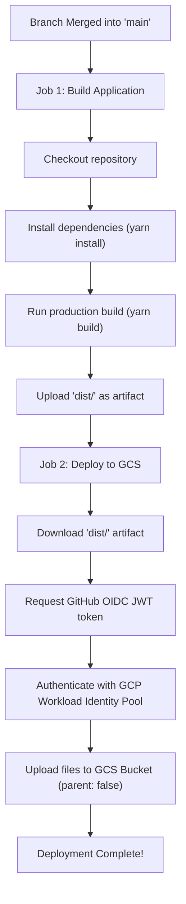

# Deployment Guide: Google Cloud Storage via GitHub Actions (OIDC)

This document describes how this project builds and automatically deploys to a Google Cloud Storage (GCS) bucket whenever code is merged into the `main` branch.

Authentication uses **OpenID Connect (OIDC)** through Google Cloud's **Workload Identity Federation**, removing the need to generate or store long-lived service account key files in GitHub.

---

## Deployment Flow in Simple English

Here is what happens step by step when you merge your work:

- **1. Trigger on Merge to Main**  
  Whenever a pull request or branch is merged into the `main` branch, GitHub Actions automatically starts the workflow.

- **2. Build Job Starts**  
  A clean virtual machine starts up, pulls down the latest code, and installs Node.js along with project dependencies using Yarn.

- **3. Creating the Production Bundle**  
  The build script (`yarn build`) runs to compile TypeScript, process SCSS, and bundle the React app into optimized static files inside the `dist/` directory.

- **4. Saving the Build as an Artifact**  
  GitHub Actions saves this newly created `dist/` folder as a temporary workflow artifact so the next job can use it.

- **5. Deploy Job Starts**  
  Once the build job succeeds, the deploy job begins and downloads the saved `dist/` folder.

- **6. Secure Handshake with Google Cloud (OIDC / Keyless)**  
  Instead of using a stored secret password or key file, GitHub Actions asks GitHub's token service for a short-lived, digitally signed identity token. It presents this token to Google Cloud's Workload Identity Pool, which verifies that the token came from this exact repository.

- **7. Short-Lived Access Granted**  
  Google Cloud checks that GitHub is allowed, and temporarily assumes the role of a dedicated Service Account.

- **8. Uploading to Cloud Storage**  
  The action uploads all compiled files (`index.html`, JavaScript, CSS, and assets) directly to the root of your target Google Cloud Storage bucket.

- **9. Deployment Complete**  
  The updated build is now live in the bucket, and the temporary credentials expire immediately.

---

## Workflow Diagram



---

## One-Time Setup in Google Cloud Console & CLI

To allow GitHub Actions to deploy to your bucket using OIDC, run the following commands once using Google Cloud SDK (`gcloud`):

### 1. Set Configuration Variables

Replace the placeholder values with your project details:

```bash
PROJECT_ID="your-gcp-project-id"
POOL_NAME="github-pool"
PROVIDER_NAME="github-provider"
SA_NAME="gh-actions-gcs-deployer"
REPO="your-github-username/portfolio-os" # e.g. NatsuDrag9/portfolio-os
BUCKET_NAME="your-gcs-bucket-name"
```

### 2. Create the Workload Identity Pool and OIDC Provider

```bash
# Create the pool
gcloud iam workload-identity-pools create "$POOL_NAME" \
  --project="$PROJECT_ID" \
  --location="global" \
  --display-name="GitHub Actions Pool"

# Add GitHub OIDC provider to the pool
gcloud iam workload-identity-pools providers create-oidc "$PROVIDER_NAME" \
  --project="$PROJECT_ID" \
  --location="global" \
  --workload-identity-pool="$POOL_NAME" \
  --display-name="GitHub OIDC Provider" \
  --issuer-uri="https://token.actions.githubusercontent.com" \
  --attribute-mapping="google.subject=assertion.sub,attribute.actor=assertion.actor,attribute.repository=assertion.repository" \
  --attribute-condition="assertion.repository=='$REPO'"
```

### 3. Create the Service Account and Grant Storage Access

```bash
# Create the Service Account
gcloud iam service-accounts create "$SA_NAME" \
  --project="$PROJECT_ID" \
  --display-name="GitHub Actions GCS Deployer"

# Grant the Service Account Object Admin rights to the bucket
gcloud storage buckets add-iam-policy-binding "gs://$BUCKET_NAME" \
  --member="serviceAccount:$SA_NAME@$PROJECT_ID.iam.gserviceaccount.com" \
  --role="roles/storage.objectAdmin"
```

### 4. Link the Repository to the Service Account

```bash
# Find your project number
PROJECT_NUMBER=$(gcloud projects describe "$PROJECT_ID" --format="value(projectNumber)")

# Grant the Workload Identity User role to your repository
gcloud iam service-accounts add-iam-policy-binding \
  "$SA_NAME@$PROJECT_ID.iam.gserviceaccount.com" \
  --role="roles/iam.workloadIdentityUser" \
  --member="principalSet://iam.googleapis.com/projects/$PROJECT_NUMBER/locations/global/workloadIdentityPools/$POOL_NAME/attribute.repository/$REPO"
```

---

## GitHub Repository Secrets & Variables

In your GitHub repository, navigate to **Settings** > **Secrets and variables** > **Actions** and add the following entries:

| Name | Type | Value | Example |
| :--- | :--- | :--- | :--- |
| `GCP_WORKLOAD_IDENTITY_PROVIDER` | Secret or Variable | Full path to the identity provider | `projects/<PROJECT_NUMBER>/locations/global/workloadIdentityPools/github-pool/providers/github-provider` |
| `GCP_SERVICE_ACCOUNT` | Secret or Variable | Email address of the Service Account | `gh-actions-gcs-deployer@<PROJECT_ID>.iam.gserviceaccount.com` |
| `GCP_STORAGE_BUCKET` | Secret or Variable | Name of your GCS bucket | `my-portfolio-bucket` |

---

## Workflow File Location

The GitHub Actions configuration is stored at:
[`.github/workflows/deploy-gcs.yml`](file:///home/rohitimandi/Desktop/Rohit/Personal/Online_Project_Uploads/portfolio-os/.github/workflows/deploy-gcs.yml)
